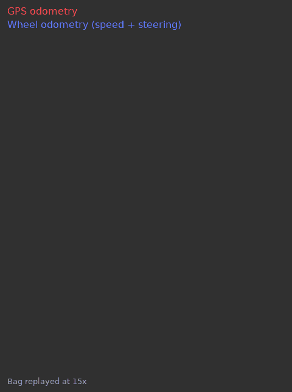

# Vehicle Odometry & Lap Sector Timing (ROS1)

A ROS1 (C++) package that estimates a car's trajectory around a race track using two independent sources, wheel odometry and GPS, and computes live sector times and mean speeds.

Built as the first project for the **Robotics** course at **Politecnico di Milano** (2025) by:
- Zheng Jin fa
- Zhang XiangYu

The nodes process a recorded drive (a ROS bag) of a real vehicle. Its GPS reference point is at the Autodromo Nazionale di Monza.

<p align="center"></p>

The GIF shows the whole recording replayed in RViz. The GPS trajectory (red) traces the circuit. The wheel odometry (blue) follows it closely at first, then drifts, because heading errors from integrating speed and steering add up over several kilometres. Comparing the two is the point of running both estimators side by side.

## What it does

The package contains three nodes, launched together with RViz for visualization:

### 1. `odom`: wheel odometry from speed and steering
- Subscribes to `/speedsteer` (`geometry_msgs/PointStamped`: steering-wheel angle in degrees, speed in km/h).
- Converts the steering-wheel angle to a front-wheel angle (steering ratio 32) and integrates a **kinematic bicycle model** (wheelbase 1.765 m) over each message's timestamp.
- Applies a ±10° dead-band to the steering input to reduce the drift caused by a small steering offset at the start of the recording.
- Rotates the result into the same axes as the GPS frame so that the two trajectories can be compared directly.
- Publishes `nav_msgs/Odometry` on `/odom` and the TF `world → odom-vehicle`.

### 2. `gps_odometer`: GPS to local Cartesian odometry
- Subscribes to `/swiftnav/front/gps_pose` (`sensor_msgs/NavSatFix`).
- Converts latitude/longitude/altitude to **ECEF** (WGS84 ellipsoid), then to a local **ENU** frame centered on a configurable reference point.
- Estimates heading from consecutive positions, smoothed with a circular moving average (configurable window). The heading is held when the car moves less than 10 cm.
- Derives linear and angular velocity, handling angle wrap-around.
- **Outlier rejection:** rejects fixes that imply an implausible jump in distance or velocity, and also handles dropouts where the receiver reports lat = lon = 0 while still claiming a fix. During either, it predicts the position from the last good velocity. When real fixes return, it keeps the previous velocity instead of treating the correction as a speed spike. Readings without a GPS fix are skipped.
- All time steps come from the message timestamps, so the output is identical at any `rosbag play` rate.
- Publishes `nav_msgs/Odometry` on `/gps_odom` and the TF `world → odom-gps`.

### 3. `sector_times`: live sector timing
- Synchronizes `/speedsteer` and the GPS topic with a `message_filters` **ApproximateTime** policy. Its queues are sized so that no GPS message is dropped, even when the bag is replayed at 50×.
- Splits the track into three sectors using two dividing lines defined by GPS points A, B and C, and classifies each position.
- Tracks the time elapsed in the current sector and its running mean speed. It handles GPS dropouts, where latitude/longitude are 0, by keeping the last known sector.
- Publishes a custom message `first_project/sector_times` on `/sector_times`:
  ```
  int64   current_sector
  float64 current_sector_time
  float64 current_sector_mean_speed
  ```

## Results

All numbers below were measured on the course bag (416 s, one 5.8 km lap), replayed with `rosbag play` at the rates shown.

### Wheel odometry drift vs GPS

Each GPS fix is compared with the wheel-odometry position interpolated at the same timestamp. The 79 GPS dropouts are left out. Distance driven is integrated from the wheel speed.

| Distance driven | Position error vs GPS |
|---|---|
| 0.5 km | 42 m |
| 1 km | 37 m |
| 2 km | 562 m |
| 3 km | 590 m |
| 4 km | 663 m |
| 5 km | 1,352 m |

Over the whole lap the error is 508 m on average, with an RMSE of 641 m and a maximum of 1,367 m. The odometry is accurate for the first kilometre, then drifts once heading errors build up through the corners. It ends only 260 m from the GPS position, but only because the lap loops back near its start, so that number understates the drift.

### Bug fixes, before and after

`gps_odometer`:

| | Original | Fixed |
|---|---|---|
| Median speed, bag at 1× | 52.8 km/h | 52.8 km/h |
| Median speed, bag at 10× | 455 km/h | 52.8 km/h |
| Max speed, bag at 1× | 296 km/h (spike after a dropout) | 77 km/h |
| Largest altitude (`z`) published | 1,965 km | 12 m |
| False "GPS jump" warnings, 1× / 10× | 79 / 2,786 | 0 / 0 |

The original computed time steps from the wall clock, so every speed scaled with the playback rate. GPS dropouts (lat = lon = 0) also leaked a garbage altitude into the output and caused a speed spike when the signal returned.

`sector_times`, messages published out of 4,158 GPS fixes:

| Bag rate | Original (queue 1) | Fixed (queue 100) |
|---|---|---|
| 10× | 4,157 | 4,158 |
| 30× | 4,149 | 4,158 |
| 50× | 4,123 | 4,158 |

With the fix, the output is identical at 1×, 10× and 50×, message for message.

## Topics and frames

| Node | Subscribes | Publishes | TF |
|---|---|---|---|
| `odom` | `/speedsteer` | `/odom` | `world → odom-vehicle` |
| `gps_odometer` | `/swiftnav/front/gps_pose` | `/gps_odom` | `world → odom-gps` |
| `sector_times` | `/speedsteer`, `/swiftnav/front/gps_pose` | `/sector_times` | — |

## Parameters

All parameters are set in [`launch/launch.launch`](launch/launch.launch).

| Node | Parameter | Meaning |
|---|---|---|
| `gps_odometer` | `lat_r`, `lon_r`, `alt_r` | ENU reference point |
| `gps_odometer` | `max_acceptable_distance`, `max_acceptable_velocity` | Outlier-rejection thresholds (m, m/s) |
| `gps_odometer` | `heading_window_size` | Moving-average window for heading |
| `sector_times` | `LAT_A`, `LONG_A`, `LAT_B`, `LONG_B`, `LAT_C`, `LONG_C` | Points defining the sector boundaries |

## Build and run

Requires ROS1 Noetic. The package was developed in the course's Docker image (`smentasti/robotics`). The bag (`project.bag`) was provided by the course and is not included in this repository.

```bash
cd ~/catkin_ws/src
git clone https://github.com/ZhengJinFa168/ros-vehicle-odometry.git first_project
cd ~/catkin_ws
catkin_make
source devel/setup.bash
roslaunch first_project launch.launch

# in a second terminal
rosbag play project.bag
```

## Tech
C++, ROS1 (roscpp, tf / tf2, message_filters, custom messages), RViz, Docker, coordinate-frame transforms (WGS84 → ECEF → ENU), kinematic vehicle modeling.

## Known limitations
- Wheel odometry is pure dead reckoning, so it drifts over a long drive: 508 m mean error over one lap (see [Results](#results)). It isn't fused with GPS.
- The sector boundaries are straight lines computed in latitude/longitude space, which is accurate enough over the size of a track but is not a true metric projection.
